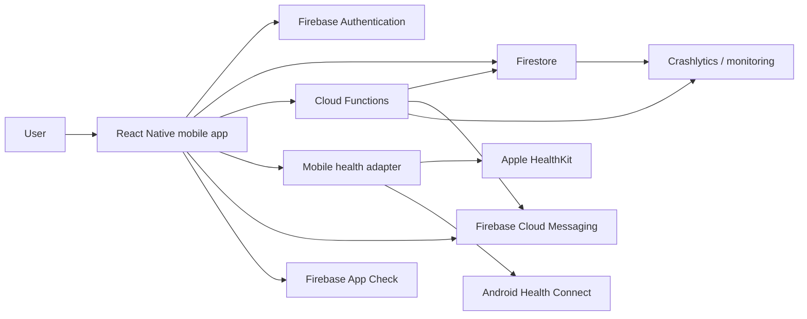

# Fitness Activity Tracker — Master Architecture

**Status:** Proposed baseline architecture  
**Scope:** Mobile app for recording workouts, tracking daily steps, and setting goals  
**Baseline stack from project brief:** React Native, JavaScript, Firebase

## 1. Product goal and assumptions

The app gives a signed-in person a simple place to:

- Record, edit, and review workouts.
- View daily step totals and recent activity.
- Set and track measurable goals, such as a daily step target or weekly workout count.
- Control whether the app reads step data from the phone's health platform.

This design assumes an individual-focused MVP. It does not assume social feeds, coach accounts, medical recommendations, live GPS route tracking, or a web admin portal. Those can be added later without changing the core ownership model.

**Important constraint:** React Native and Firebase do not themselves collect reliable background step counts. Step tracking should be integrated through HealthKit on iOS and Health Connect on Android, with explicit user permission. If those integrations are out of scope for the first release, label steps as manually entered or provide a clearly scoped foreground-only pedometer; do not imply continuous automatic tracking.

## 2. Architecture at a glance



The mobile app is organized as a modular client. Firebase provides managed authentication, database, server functions, and notifications. Cloud Functions handle trusted operations and derived data; the app never embeds privileged service credentials.

## 3. Recommended technology choices

| Area | Recommendation | Purpose |
|---|---|---|
| Mobile | React Native, JavaScript (TypeScript is a sensible later upgrade) | One iOS and Android application |
| Navigation | React Navigation | Auth flow and main tab navigation |
| Server state | Firebase client SDK + a small repository/service layer | Authenticated Firestore access and offline persistence |
| Local UI state | React Context for session/preferences; component state for transient UI | Avoid over-engineering a small MVP |
| Backend | Firebase Cloud Functions, Node.js, 2nd gen | Trusted validation, summaries, reminders, account deletion |
| Identity | Firebase Authentication | Email/password initially; optional Apple/Google sign-in later |
| Database | Cloud Firestore | User-owned records, realtime updates, offline-capable reads/writes |
| Step source | HealthKit (iOS), Health Connect (Android) through native-compatible libraries | User-authorized activity import |
| Push | Firebase Cloud Messaging | Goal reminders and optional notifications |
| Reliability | Firebase Crashlytics; Analytics only if product needs justify it | Crash visibility and carefully scoped product events |
| Abuse protection | Firebase App Check + Firestore Rules + function validation | Reduce unauthorized clients and enforce ownership |

For native health APIs, choose a React Native setup/library that supports both target platforms and current OS requirements before implementation. Verify maintenance, privacy behavior, and Expo/bare-workflow compatibility rather than assuming a package is suitable.

## 4. App modules and responsibilities

### Mobile app

- **Authentication:** sign-in, registration, password reset, sign-out, session restoration.
- **Dashboard:** today's step total, goal progress, recent workout, quick actions.
- **Workouts:** create, edit, delete, list, and detail views.
- **Steps:** permission state, source connection, sync status, daily history.
- **Goals:** create/update/complete goals and calculate progress.
- **History and insights:** daily/weekly summaries from stored records.
- **Settings and privacy:** health data connection, notification preferences, export/delete account.

### Firebase services

- **Authentication:** supplies a stable Firebase UID; all user data is keyed by it.
- **Firestore:** stores user profile, user-entered workout records, goals, and daily activity summaries.
- **Cloud Functions:** validates privileged requests, maintains derived summaries, sends scheduled reminders if enabled, and performs account deletion.
- **FCM:** optional notification delivery; tokens are user-scoped and revocable.
- **App Check:** enable for production clients and callable functions where supported.

## 5. Main user flows

### First use

1. User creates an account or signs in.
2. App creates a minimal profile document using the authenticated UID.
3. User lands on the dashboard; health permissions are not requested without explaining why.
4. When the user enables step sync, show platform-specific rationale, request only step-read access, and present a useful state if denied.

### Log a workout

1. User enters activity type, start time, duration, and optional notes/metrics.
2. Client validates required fields and writes an owned workout record.
3. Firestore returns the saved record; UI confirms success and handles offline pending writes.
4. A trusted function or a deterministic client query updates dashboard summaries. Avoid maintaining multiple conflicting copies of workout totals.

### Sync steps

1. Health adapter checks platform availability and current permission.
2. Read an allowed date range and aggregate step intervals into the user's local calendar day.
3. Upsert daily totals with a stable key and source metadata; repeat syncs must be idempotent.
4. Re-check permission when syncing because users can revoke it in system settings.
5. Show last successful sync and allow pause/disconnect. Do not promise background sync until verified on both OSes.

### Track a goal

1. User creates a goal with a metric, target, period, start date, and optional end date.
2. Dashboard calculates progress against daily activity/workout records.
3. Goal progress is derived data; store it only if needed for efficient display, and define how it is recalculated after edits/deletions.

## 6. Firestore data model

Use the Firebase Auth UID as the ownership boundary. Keep user records under `users/{uid}` so security rules and account deletion are straightforward.

```text
users/{uid}
  displayName, email, createdAt, updatedAt, timezone, units

users/{uid}/workouts/{workoutId}
  type, startedAt, durationSeconds, notes?, metrics?, createdAt, updatedAt

users/{uid}/dailyActivity/{yyyy-MM-dd}
  date, timezone, steps, stepSource, sourceUpdatedAt, syncedAt,
  workoutCount?, activeMinutes?, updatedAt

users/{uid}/goals/{goalId}
  metric, target, period, startsOn, endsOn?, status, createdAt, updatedAt

users/{uid}/deviceConnections/{connectionId}
  platform, provider, enabled, grantedScopes, lastSyncAt?, lastSyncStatus?, updatedAt

users/{uid}/notificationTokens/{tokenId}
  token, platform, createdAt, updatedAt
```

### Data rules

- Use UTC timestamps (`createdAt`, `startedAt`) for events; keep an IANA timezone on the user profile to define daily boundaries.
- `yyyy-MM-dd` daily keys represent that user's local calendar day, not UTC midnight.
- Keep `steps` as an integer. Store source and sync timestamps so imported data can be explained and refreshed.
- Store workout metrics in a validated, versioned shape. Do not accept arbitrary unbounded objects from clients.
- Do not store continuous sensor samples or precise location unless a later feature clearly needs them.
- Decide source precedence before merging step records from multiple providers, to avoid double counting. Prefer health-platform aggregation where possible; never blindly sum overlapping sources.
- Avoid duplicating summaries until needed. If summaries are stored, define the source records and recomputation path as the source of truth.

## 7. Backend boundaries and operations

### Client writes (protected by rules)

Suitable for the MVP: a user creating or editing their own profile, workouts, preferences, and goals, with field validation and ownership rules.

### Callable functions (authenticated and validated)

Use for actions requiring trusted validation or multi-document consistency, such as:

- `syncDailyActivity`: accept a bounded date range and normalized totals; validate UID and input shape, then idempotently upsert.
- `rebuildUserSummaries`: recompute derived values after edits/import corrections.
- `deleteUserAccount`: delete Auth identity and all user-owned Firestore documents, tokens, and optional Storage files.
- `sendGoalReminder`: scheduled or event-driven reminder after notification preferences and quiet hours are checked.

Functions must derive the user identity from the verified auth context, never trust a client-supplied UID. Add idempotency keys or stable document IDs to retried operations.

### Firestore Rules baseline

- Deny access by default.
- Require `request.auth.uid == uid` for reads and writes under `users/{uid}`.
- Validate allowed fields, types, bounds, and immutable ownership/timestamps where practical.
- Do not allow clients to write administrative fields or cross-user records.
- Keep rules in source control and deploy them with the app configuration.
- Test rules with the Firebase Emulator Suite before real-user data is introduced.

## 8. Suggested repository structure

```text
fitness-activity-tracker/
  apps/
    mobile/
      src/
        app/                 # app entry, navigation, providers
        features/
          auth/
          dashboard/
          workouts/
          steps/
          goals/
          settings/
        components/          # reusable UI components
        services/
          firebase/          # SDK setup, auth, Firestore adapters
          health/            # HealthKit/Health Connect adapter interface
          notifications/
        hooks/
        utils/               # dates, validation, formatting
        theme/
      assets/
      App.js
  functions/
    src/
      auth/
      activity/
      goals/
      notifications/
      shared/
      index.js
  firestore.rules
  firestore.indexes.json
  firebase.json
  .env.example
  README.md
```

Keep screens thin: they call feature services/hooks; services handle persistence and platform APIs. A `HealthDataProvider` interface should hide OS-specific behavior behind methods such as `isAvailable()`, `requestStepReadPermission()`, `readSteps(start, end)`, and `getConnectionStatus()`.

## 9. Security, privacy, and reliability

- Treat step counts and workout history as sensitive personal data. Explain data use before permission prompts and collect only required fields.
- Keep Firebase Admin credentials exclusively in managed server environments; never commit service account keys or secrets.
- Use least-privilege Firestore rules, App Check, callable-function validation, and rate limits for expensive operations.
- Provide account deletion and disclose what happens to cloud records and device health permissions. Deleting the app's records does not automatically erase the platform's own health history.
- Make sync retryable and idempotent; show stale/offline states rather than presenting old data as current.
- Use Firebase Emulator Suite for Auth, Firestore, Functions, and rules during development; separate development and production Firebase projects.
- Establish a retention policy before collecting data beyond the MVP.

## 10. Release and environment plan

- **Local:** Firebase Emulator Suite, mock health adapter, sample data.
- **Development:** dedicated Firebase project, internal app builds, real-device permission checks.
- **Production:** separate Firebase project, restricted API keys, App Check enforcement, indexes/rules deployed, crash reporting enabled.
- Configure secrets through the platform's secret manager or CI environment; `.env.example` documents names only and contains no secrets.
- Health permission declarations and store disclosures must match the exact features implemented.

## 11. MVP sequence and acceptance criteria

### Phase 1 — Foundation

- App shell, navigation, Firebase project setup, authentication, profile, environments, rules.
- Acceptance: signed-out users cannot read private data; signed-in user sees only their own profile.

### Phase 2 — Workouts and goals

- Create/edit/delete workouts, workout history, create step/workout goals, dashboard progress.
- Acceptance: records survive relaunch and offline changes reconcile without duplicates.

### Phase 3 — Step integration

- iOS HealthKit and Android Health Connect adapters, permission states, daily aggregation, manual refresh.
- Acceptance: denied/revoked permission and unavailable provider states are handled; repeated sync does not inflate counts.

### Phase 4 — Hardening

- Account deletion, notification preferences, error handling, accessibility, privacy disclosures, real-device validation.
- Acceptance: rules and functions are verified in emulators; production build uses a separate project and no privileged secrets in the app.

## 12. Decisions to confirm before implementation

1. Are iOS and Android both required for the first release?
2. Should step counts be automatic via HealthKit/Health Connect, or is manual/foreground-only entry acceptable for the MVP?
3. Are accounts required, or must the app support anonymous/local use?
4. Should workout entry be manual only, or is GPS/live workout recording in scope?
5. Are reminders, social features, or coach/admin roles required?

Until answered, the recommended MVP is account-based, manual workout logging, optional read-only step import from platform health stores, daily/weekly goals, and no social or GPS features.

## References

- [Firebase Authentication](https://firebase.google.com/docs/auth)
- [Cloud Firestore](https://firebase.google.com/docs/firestore)
- [Firebase callable functions](https://firebase.google.com/docs/functions/callable)
- [Firebase App Check](https://firebase.google.com/docs/app-check)
- [Android Health Connect step tracking](https://developer.android.com/health-and-fitness/health-connect/features/steps)
- [Apple HealthKit](https://developer.apple.com/documentation/healthkit)
