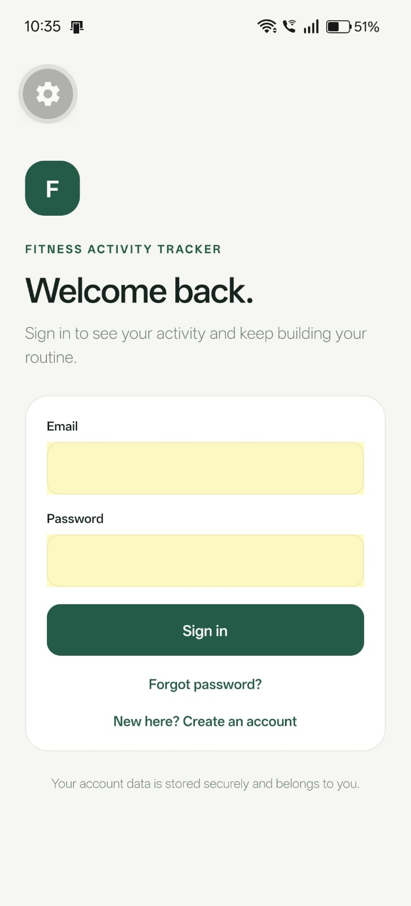
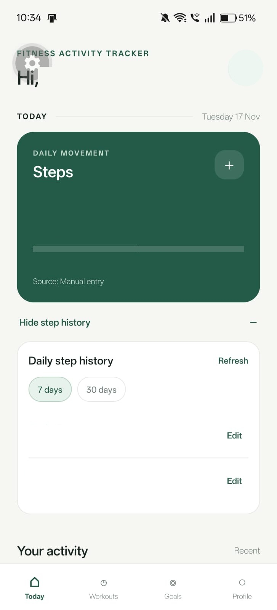
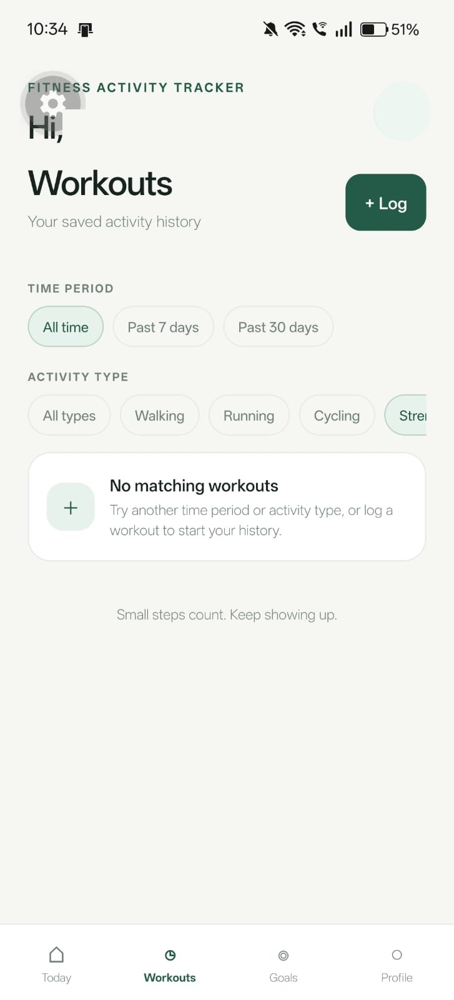
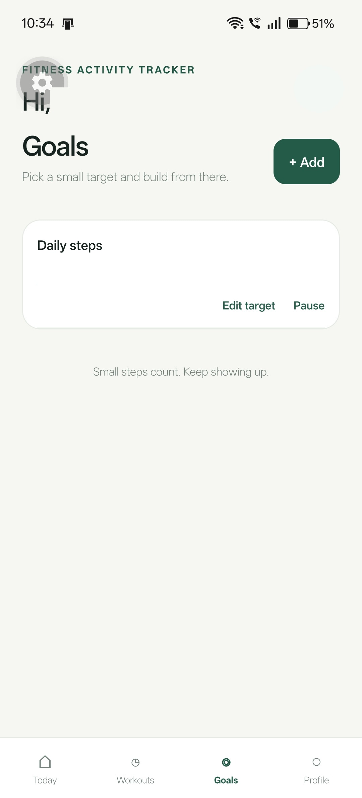
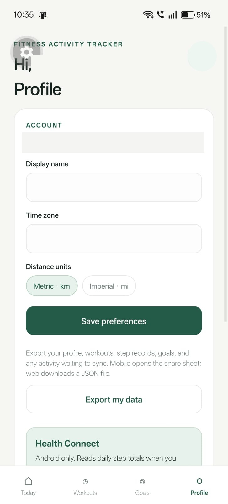

# Fitness Activity Tracker

A mobile fitness activity tracker for logging workouts, recording daily steps, setting goals, and reviewing progress. The project is a JavaScript monorepo with a React Native app, a Node.js/Express REST API, and MySQL.

## Table of contents

- [Overview](#overview)
- [Features](#features)
- [Screenshots](#screenshots)
- [Data](#data)
- [Technology](#technology)
- [Project flow](#project-flow)
- [Run locally](#run-locally)
- [Project structure](#project-structure)
- [Status and next steps](#status-and-next-steps)
- [Documentation](#documentation)
- [Author](#author)

## Overview

The app brings everyday activity tracking into one place. Users can record workouts, track steps manually or optionally sync recent daily totals from Android Health Connect, and see progress toward personal goals. The API owns validation, authentication, and database access; the mobile app never connects directly to MySQL.

## Features

- Account registration, sign-in, password recovery, profile preferences, and account deletion.
- Workout history with create, edit, delete, date/type filters, and pagination.
- Daily step entry and history, plus Android Health Connect sync on user action.
- Daily and weekly goals with progress summaries.
- Offline queue for manual step entries and workout changes.
- User data export and timezone-aware activity summaries.
- Secure native token storage and account-scoped activity data.

## Screenshots

The screens below show the app UI. Names, email addresses, login entries, and personal step/progress values have been removed from the public screenshot copies.

| Screen | Preview | What it shows |
| --- | --- | --- |
| **Sign in** |  | Existing-user login and password-recovery navigation. Entered account values are cleared. |
| **Create account** |  | Registration form with optional display name and account fields. |
| **Password recovery** |  | Request a reset code or continue with a code already received. |
| **Today dashboard** |  | Daily steps card, step-history controls, and activity overview. Personal step values are removed. |
| **Workouts** |  | Workout history filters, activity-type selection, and the empty state. |
| **Goals** |  | Daily goal progress and controls to edit or pause a goal. Personal progress values are removed. |
| **Profile** |  | Profile preferences, data export, and the Android Health Connect section. Account details are removed. |

## Data

There is no bundled third-party dataset. Activity records are entered by the user; when enabled, the Android app can read aggregated daily step totals from Health Connect after the user initiates a sync. Account and activity data are stored by the API in MySQL. Health Connect is optional, read-only, and does not sync in the background.

## Technology

- **Mobile:** React Native, Expo SDK 58, JavaScript
- **API:** Node.js 22.13+, Express 5, REST/JSON
- **Database:** MySQL 8, `mysql2`, SQL migrations
- **Authentication:** bcrypt password hashing, short-lived access tokens, rotating refresh tokens
- **Android health data:** Health Connect

## Project flow

1. The user creates an account or signs in from the mobile app.
2. The app sends authenticated requests to the Express API.
3. API routes validate requests and delegate business rules to services and repositories.
4. The API stores user-scoped records in MySQL using parameterized queries.
5. The app presents workout, step, goal, and progress data, and queues supported edits while offline.

## Run locally

### Prerequisites

- Node.js 22.13 or later and npm.
- MySQL 8.x.
- Android Studio, Android SDK, and a device/emulator with Health Connect for the native Android build. Expo Go does not include the Health Connect module.

### Setup

From the repository root, enter the app workspace and install dependencies:

```powershell
Set-Location workspace
npm install
Copy-Item .env.example .env
```

Set the local MySQL values in `workspace/.env` (never commit this file), start MySQL, then apply migrations:

```powershell
npm run migrate
```

Start the API in one terminal:

```powershell
npm run dev:api
```

In another terminal, from the `workspace` directory, build and run the Android development app:

```powershell
npm run android --workspace @fitness-tracker/mobile
```

The API readiness endpoint is `http://localhost:3000/api/v1/health/ready`. For iOS manual-entry previews, use Expo Go with `npm run start:mobile:go`; Health Connect is Android-only in the current implementation. See [database setup](workspace/database/README.md) for MySQL privileges and [the workspace guide](workspace/README.md) for device/network notes.

## Project structure

```text
fitness_activity_tracker/
├── README.md
└── workspace/
    ├── apps/
    │   ├── api/          # Express API, services, repositories, migrations runner
    │   └── mobile/       # Expo React Native app and platform services
    ├── database/
    │   └── migrations/   # Ordered MySQL schema migrations
    ├── docs/             # API contract and privacy notice
    ├── screenshots/      # Public demo screenshots
    ├── package.json
    └── .env.example
```

## Status and next steps

This is an actively developed project and is not presented as a production service. The Android Health Connect native flow still needs device/build validation. Before any app-store release, the privacy notice needs a stable public HTTPS URL and support contact, and deployment/security settings need to be completed.

Planned next steps include validating the Android development build on a device, preparing deployment configuration, and continuing UI/accessibility polish.

## Documentation

- [API contract](workspace/docs/API.md)
- [Privacy notice](workspace/docs/PRIVACY_POLICY.md) (draft; see release requirements above)
- [Local database setup](workspace/database/README.md)
- [Workspace run guide](workspace/README.md)

## Author

Created by [sairajbitla6-2007](https://github.com/sairajbitla6-2007). Feedback and suggestions are welcome through GitHub.
